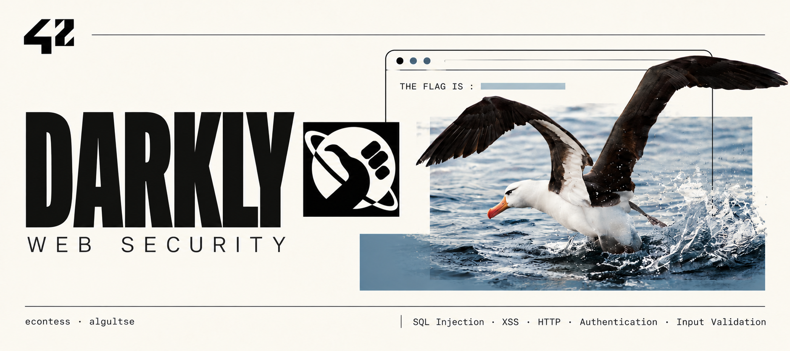
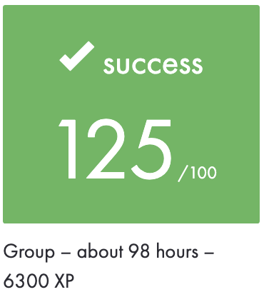
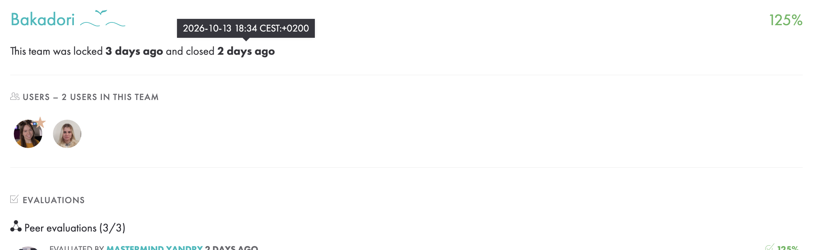

<!-- 
|           Grade          |                           |
|:------------------------:|:-------------------------:|
|  |  |
  -->
<br>

---

<br>

---

<details>
<summary>🇬🇧 ENGLISH VERSION</summary>

## Preamble

This <a href="./subject/Darkly.en.subject.pdf">project</a> introducing web application security through a deliberately vulnerable website distributed as a virtual machine image. The goal is to discover vulnerabilities, reproduce them, retrieve the associated flags, and explain their causes and possible mitigations.

This repository contains **14 documented challenges**, each with a saved flag and a writeup in `Resources/`.

## Project goals

- Inspect pages, forms, URLs, cookies, HTTP headers, and exposed files.
- Understand how untrusted input crosses the boundary between the browser and the server.
- Reproduce each finding and explain the steps that lead to the flag.
- Connect each weakness to its potential impact and an appropriate mitigation.

## Installation & launch

Use a VM or emulator capable of booting the **32-bit x86** ISO.
```bash
make iso
```

1. Create a virtual machine and attach `Darkly_i386.iso` as its boot media.
2. Start the VM and note the IP address displayed by Darkly.
3. Configure the VM network so the host can reach its web server.
4. Open the address in your browser.  
With NAT port forwarding from host port `8080` to guest port `80`, use `http://127.0.0.1:8080`.  
Otherwise, use the reachable VM address.

```bash
export DARKLY_URL="http://127.0.0.1:8080"
curl -I "$DARKLY_URL/"
```

## The 14 challenges

| # | Challenge / writeup | What is investigated |
| --- | --- | --- |
| 1 | [SQL_injection_basic](./SQL_injection_basic/Resources/SQL_injection_basic_writeup.md) | SQL injection through the member ID; extraction of hidden database fields. |
| 2 | [SQL_injection_avancee](./SQL_injection_avancee/Resources/SQL_injection_avancee_writeup.md) | SQL injection through the image ID; schema discovery and HEX literals. |
| 3 | [Include](./Include/Resources/Include_writeup.md) | Path traversal through `page` and the local file inclusion scenario. |
| 4 | [XSS_basic](./XSS_basic/Resources/XSS_Feedback_writeup.md) | Stored XSS through the Name field of the feedback form. |
| 5 | [XSS_advanced](./XSS_advanced/Resources/XSS_advanced_writeup.md) | HTML content supplied through a `data:` URL in `<object data>`. |
| 6 | [Cookies](./Cookies/Resources/Cookies_writeup.md) | Client-controlled `I_am_admin` cookie and predictable hashed values. |
| 7 | [Spoof](./Spoof/Resources/Spoof_writeup.md) | Client-controlled `Referer` and `User-Agent` headers. |
| 8 | [Admin](./Admin/Resources/Admin_htpasswd_writeup.md) | Exposed `htpasswd` file, password recovery, and administrator login. |
| 9 | [Bruteforce](./Bruteforce/Resources/Bruteforce_writeup.md) | In this solution: hash extraction through SQLi, offline dictionary guessing, then login. |
| 10 | [File_upload](./File_upload/Resources/File_upload_writeup.md) | Upload validation based on a client-supplied MIME type. |
| 11 | [Redirect](./Redirect/Resources/Redirect_writeup.md) | Manipulation of the redirect destination through `site`. |
| 12 | [Guess](./Guess/Resources/Guess_writeup.md) | Automated exploration of the public `/.hidden/` directory tree. |
| 13 | [Survey](./Survey/Resources/Survey_writeup.md) | Submission of a rating outside the range offered by the form. |
| 14 | [Recover](./Recover/Resources/Recover_writeup.md) | Modification of the hidden `mail` field in password recovery. |

  <details>
  <summary>Short description of the main concepts</summary>

  ### SQL injection

  User input changes the structure of a database query. Parameterized queries separate query code from values; server-side validation and restricted database permissions add protection.

  ### Cross-site scripting (XSS)

  Untrusted input is interpreted as active browser content. Stored XSS persists in saved content. Defenses depend on the output context: escaping, HTML sanitization when rich text is allowed, and validation of resource URLs.

  ### File inclusion & exposed resources

  User-controlled paths or publicly served files can reveal data. Fixed mappings for allowed pages, access checks, and keeping sensitive files outside the public web directory address different parts of this problem.

  ### Client-controlled data

  Cookies, hidden fields, dropdown values, and HTTP headers can be changed by the client. The server must validate inputs and determine permissions from trusted state.

  ### Passwords & hashing

  Hashing is different from encryption. Dictionary guessing compares candidate hashes with a target hash. Login rate limits address online attempts; salted password hashing such as Argon2id or bcrypt makes offline guessing more expensive.

  ### File upload & redirects

  Uploaded files need content validation and safe storage without code execution. Redirect destinations should be selected from an explicit set of allowed locations.

  </details>

</details>

---

<details>
<summary>🇫🇷 FRENCH VERSION</summary>

## Préambule

Ce <a href="./subject/Darkly.en.subject.pdf">projet</a> consacré à la sécurité des applications web à travers un site volontairement vulnérable, fourni sous forme d’image de machine virtuelle. L’objectif est de découvrir des vulnérabilités, de les reproduire, de récupérer les flags associés et d’en expliquer les causes ainsi que les protections possibles.

Ce dépôt contient **14 exercices documentés**, chacun avec un flag enregistré et une explication dans `Resources/`.

## Objectifs du projet

- Examiner les pages, formulaires, URL, cookies, en-têtes HTTP et fichiers exposés.
- Comprendre comment des données non fiables circulent entre le navigateur et le serveur.
- Reproduire chaque faille et expliquer les étapes menant au flag.
- Relier chaque faiblesse à ses conséquences possibles et à une protection adaptée.

## Installation et lancement

Utiliser une VM ou un émulateur capable de démarrer une ISO **x86 32 bits**.
```bash
make iso
```

1. Créer une machine virtuelle et utiliser `Darkly_i386.iso` comme support de démarrage.
2. Démarrer la VM et relever l’adresse IP affichée par Darkly.
3. Configurer le réseau de la VM pour que la machine hôte puisse accéder au serveur web.
4. Ouvrir cette adresse dans le navigateur.  
Avec une redirection NAT du port `8080` de l’hôte vers le port `80` de la VM, utiliser `http://127.0.0.1:8080`.  
Sinon, utiliser l’adresse accessible de la VM.

```bash
export DARKLY_URL="http://127.0.0.1:8080"
curl -I "$DARKLY_URL/"
```

## Les 14 exercices

| N° | Exercice / explication | Sujet étudié |
| --- | --- | --- |
| 1 | [SQL_injection_basic](./SQL_injection_basic/Resources/SQL_injection_basic_writeup.md) | Injection SQL via l’ID d’un membre ; extraction de champs cachés de la base. |
| 2 | [SQL_injection_avancee](./SQL_injection_avancee/Resources/SQL_injection_avancee_writeup.md) | Injection SQL via l’ID d’une image ; découverte du schéma et littéraux HEX. |
| 3 | [Include](./Include/Resources/Include_writeup.md) | Traversée de répertoires via `page` et scénario d’inclusion de fichier local. |
| 4 | [XSS_basic](./XSS_basic/Resources/XSS_Feedback_writeup.md) | XSS stockée via le champ Name du formulaire de commentaires. |
| 5 | [XSS_advanced](./XSS_advanced/Resources/XSS_advanced_writeup.md) | Contenu HTML transmis par une URL `data:` dans `<object data>`. |
| 6 | [Cookies](./Cookies/Resources/Cookies_writeup.md) | Cookie `I_am_admin` contrôlé par le client et valeurs hachées prévisibles. |
| 7 | [Spoof](./Spoof/Resources/Spoof_writeup.md) | En-têtes `Referer` et `User-Agent` contrôlés par le client. |
| 8 | [Admin](./Admin/Resources/Admin_htpasswd_writeup.md) | Fichier `htpasswd` exposé, récupération du mot de passe et connexion administrateur. |
| 9 | [Bruteforce](./Bruteforce/Resources/Bruteforce_writeup.md) | Dans cette solution : extraction du hash par SQLi, recherche hors ligne par dictionnaire, puis connexion. |
| 10 | [File_upload](./File_upload/Resources/File_upload_writeup.md) | Validation d’un fichier à partir du type MIME fourni par le client. |
| 11 | [Redirect](./Redirect/Resources/Redirect_writeup.md) | Modification de la destination de redirection via `site`. |
| 12 | [Guess](./Guess/Resources/Guess_writeup.md) | Exploration automatisée de l’arborescence publique `/.hidden/`. |
| 13 | [Survey](./Survey/Resources/Survey_writeup.md) | Envoi d’une note hors de la plage proposée par le formulaire. |
| 14 | [Recover](./Recover/Resources/Recover_writeup.md) | Modification du champ caché `mail` lors de la récupération du mot de passe. |

  <details>
  <summary>Brève description des notions principales</summary>

  ### Injection SQL

  Une entrée utilisateur modifie la structure d’une requête SQL. Les requêtes paramétrées séparent le code SQL des valeurs ; la validation côté serveur et des droits limités sur la base apportent une protection complémentaire.

  ### Cross-site scripting (XSS)

  Une entrée non fiable est interprétée comme du contenu actif par le navigateur. Une XSS stockée persiste dans les données enregistrées. La protection dépend du contexte de sortie : échappement, assainissement du HTML si le texte enrichi est autorisé, et validation des URL des ressources.

  ### Inclusion de fichiers et ressources exposées

  Des chemins contrôlés par l’utilisateur ou des fichiers accessibles publiquement peuvent révéler des données. Une correspondance fixe entre pages et fichiers, des contrôles d’accès et le stockage des secrets hors du répertoire web public répondent à différents aspects du problème.

  ### Données contrôlées par le client

  Les cookies, champs cachés, valeurs des listes déroulantes et en-têtes HTTP peuvent être modifiés par le client. Le serveur doit valider les entrées et déterminer les droits à partir de données fiables.

  ### Mots de passe et hachage

  Le hachage est différent du chiffrement. Une recherche par dictionnaire compare les empreintes des candidats à une empreinte cible. La limitation des tentatives protège la connexion ; un hachage de mots de passe avec sel, comme Argon2id ou bcrypt, ralentit la recherche hors ligne.

  ### Téléversement de fichiers et redirections

  Les fichiers reçus nécessitent une validation du contenu et un stockage empêchant leur exécution. Les destinations de redirection doivent appartenir à un ensemble explicite d’adresses autorisées.

  </details>

</details>

---

<details>
<summary>🇷🇺 RUSSIAN VERSION</summary>

## Преамбула

Этот <a href="./subject/Darkly.en.subject.pdf">проект</a> посвящён безопасности веб-приложений. Работа выполняется на специально уязвимом сайте, который поставляется в образе виртуальной машины. Цель — найти уязвимости, воспроизвести их, получить соответствующие флаги и объяснить причины ошибок и способы защиты.

В репозитории **14 задокументированных заданий**: для каждого сохранён флаг и подготовлен разбор в `Resources/`.

## Цели проекта

- Исследовать страницы, формы, URL, cookies, HTTP-заголовки и доступные файлы.
- Понять, как недоверенные данные передаются между браузером и сервером.
- Воспроизвести каждую уязвимость и объяснить шаги получения флага.
- Связать каждую ошибку с возможными последствиями и подходящим способом защиты.

## Установка и запуск

Понадобятся виртуальная машина или эмулятор с поддержкой загрузки **32-битного x86**-образа.
```bash
make iso
```

1. Создай виртуальную машину и подключи `Darkly_i386.iso` как загрузочный образ.
2. Запусти VM и запиши IP-адрес, который показывает Darkly.
3. Настрой сеть VM так, чтобы с основного компьютера был доступен её веб-сервер.
4. Открой адрес в браузере.  
При NAT с перенаправлением порта `8080` основного компьютера на порт `80` VM используй `http://127.0.0.1:8080`.  
В остальных случаях используй доступный адрес VM.

```bash
export DARKLY_URL="http://127.0.0.1:8080"
curl -I "$DARKLY_URL/"
```

## 14 заданий

| № | Задание / разбор | Что исследуется |
| --- | --- | --- |
| 1 | [SQL_injection_basic](./SQL_injection_basic/Resources/SQL_injection_basic_writeup.md) | SQL-инъекция через ID участника и получение скрытых полей базы. |
| 2 | [SQL_injection_avancee](./SQL_injection_avancee/Resources/SQL_injection_avancee_writeup.md) | SQL-инъекция через ID изображения, исследование схемы и HEX-литералы. |
| 3 | [Include](./Include/Resources/Include_writeup.md) | Обход каталогов через `page` и сценарий включения локального файла. |
| 4 | [XSS_basic](./XSS_basic/Resources/XSS_Feedback_writeup.md) | Сохранённый XSS через поле Name в форме Feedback. |
| 5 | [XSS_advanced](./XSS_advanced/Resources/XSS_advanced_writeup.md) | Передача HTML через URL со схемой `data:` в `<object data>`. |
| 6 | [Cookies](./Cookies/Resources/Cookies_writeup.md) | Изменяемая клиентом cookie `I_am_admin` и предсказуемые хэши. |
| 7 | [Spoof](./Spoof/Resources/Spoof_writeup.md) | Подмена клиентских заголовков `Referer` и `User-Agent`. |
| 8 | [Admin](./Admin/Resources/Admin_htpasswd_writeup.md) | Доступный файл `htpasswd`, подбор пароля и вход в админку. |
| 9 | [Bruteforce](./Bruteforce/Resources/Bruteforce_writeup.md) | В этом решении: получение хэша через SQLi, офлайн-подбор по словарю и вход. |
| 10 | [File_upload](./File_upload/Resources/File_upload_writeup.md) | Проверка загружаемого файла по MIME-типу, указанному клиентом. |
| 11 | [Redirect](./Redirect/Resources/Redirect_writeup.md) | Изменение назначения перенаправления через `site`. |
| 12 | [Guess](./Guess/Resources/Guess_writeup.md) | Автоматический обход публичного дерева каталогов `/.hidden/`. |
| 13 | [Survey](./Survey/Resources/Survey_writeup.md) | Отправка оценки за пределами диапазона, предлагаемого формой. |
| 14 | [Recover](./Recover/Resources/Recover_writeup.md) | Изменение скрытого поля `mail` в форме восстановления пароля. |

  <details>
  <summary>Краткое описание основных понятий</summary>

  ### SQL-инъекция

  Пользовательский ввод меняет структуру SQL-запроса. Параметризованные запросы отделяют SQL-код от значений; проверка входных данных на сервере и ограничение прав в базе дополняют защиту.

  ### Cross-site scripting (XSS)

  Браузер интерпретирует недоверенный ввод как активное содержимое. При сохранённом XSS этот ввод остаётся в сохранённых данных. Защита зависит от места вывода: экранирование, очистка HTML при разрешённом форматировании и проверка URL ресурсов.

  ### Включение файлов и доступные ресурсы

  Управляемые пользователем пути и публично доступные файлы могут раскрывать данные. Фиксированное сопоставление страниц с файлами, проверка доступа и хранение секретов вне публичной папки веб-сервера решают разные части этой проблемы.

  ### Данные, которыми управляет клиент

  Cookies, скрытые поля, значения выпадающих списков и HTTP-заголовки можно изменить. Сервер должен проверять входные данные и определять права по доверенным данным.

  ### Пароли и хэширование

  Хэширование отличается от шифрования. При словарном подборе хэши кандидатов сравниваются с искомым хэшем. Ограничение попыток защищает форму входа; хэширование паролей с солью, например Argon2id или bcrypt, замедляет офлайн-подбор.

  ### Загрузка файлов и перенаправления

  Для загружаемых файлов нужны проверка содержимого и хранение без возможности исполнения кода. Адреса перенаправлений следует выбирать из явно разрешённого набора.

  </details>

</details>

---

## Authors
Web vulnerability analysis, exploitation of security flaws, HTTP request manipulation, and documentation of 14 challenges with remediation strategies.  
Made with 🤍 by:

- [econtess](https://github.com/eddard-contessa)
- [algultse](https://github.com/N0fish)

> This project was developed as a team collaboration at Ecole 42 in October 2026.